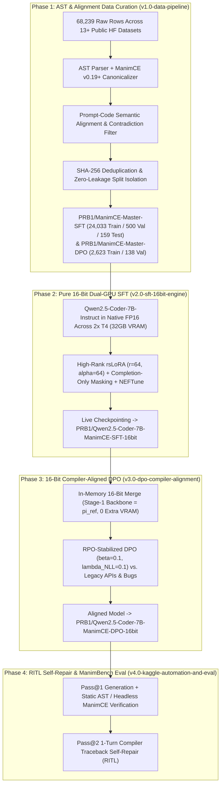

# FinetuningExps — Pure 16-Bit Dual-GPU ManimCE LLM Fine-Tuning & Compiler-Aligned Post-Training

[](https://huggingface.co/datasets/PRB1/ManimCE-Master-SFT)
[](https://huggingface.co/datasets/PRB1/ManimCE-Master-DPO)
[](https://huggingface.co/PRB1/Qwen2.5-Coder-7B-ManimCE-SFT-16bit)
[](https://huggingface.co/PRB1/Qwen2.5-Coder-7B-ManimCE-DPO-16bit)

An end-to-end, from-scratch **Pure 16-Bit (`torch.float16`) Dual-GPU Supervised Fine-Tuning (SFT) + Adapter-Reference Direct Preference Optimization (DPO) + Renderer-in-the-Loop (RITL)** framework engineered to train open-weight code LLMs (`Qwen/Qwen2.5-Coder-7B-Instruct`) to excel at **Manim Community Edition (`ManimCE v0.19+`)** mathematical animation generation on free Kaggle `GPU T4 x2` (`32 GB VRAM`) hardware—**with zero 4-bit quantization degradation**.

---

## Repository Version Branches

This repository is organized into progressive versioned release branches, each containing its own dedicated technical `README.md`:

| Branch | Milestone / Scope | Dedicated Documentation |
| :--- | :--- | :--- |
| **`v1.0-data-pipeline`** | Multi-source public dataset ingestion, AST verification, ManimCE v0.19+ canonicalizer, prompt-code alignment filter, and DPO/RITL pair synthesis. | [`docs/branches/README_v1_data.md`](docs/branches/README_v1_data.md) |
| **`v2.0-sft-16bit-engine`** | From-scratch Pure 16-Bit (`FP16`) Dual-T4 GPU `rsLoRA` ($r=64, \alpha=64$) SFT trainer with completion-only loss masking, `NEFTune` ($\alpha=5.0$), and fault-tolerant HF Hub checkpointing. | [`docs/branches/README_v2_sft.md`](docs/branches/README_v2_sft.md) |
| **`v3.0-dpo-compiler-alignment`** | Zero-memory-overhead 16-bit Adapter-Reference `DPO` + `RPO-NLL` alignment engine eliminating legacy `ManimGL`/v0.14 hallucinations and layout overlap. | [`docs/branches/README_v3_dpo.md`](docs/branches/README_v3_dpo.md) |
| **`v4.0-kaggle-automation-and-eval`** | Automated Kaggle GPU kernel deployment (`priyadharsanbalaji18/manimce-qwen25-coder-7b-16bit-sft-dpo`), 1-turn `RITL` self-repair agent, and held-out `ManimBench-v1` / `autoresearch-manim` evaluation suite. | [`docs/branches/README_v4_kaggle_eval.md`](docs/branches/README_v4_kaggle_eval.md) |
| **`main`** | Complete unified production codebase integrating all four stages. | This document (`README.md`) |

---

## 1. End-to-End Architecture



---

## 2. Empirical Dataset Curation & Sanitization Audit (`data/curation_audit_report.json`)

Our automated audit of **68,239 raw rows** across public Hugging Face Manim datasets revealed massive syntax corruption (`>23,000` invalid Python ASTs), row-shuffled prompt-code misalignments, and legacy `ManimGL` (`manimlib`) contamination. Below is the exact breakdown produced by `src/data_pipeline/build_master_dataset.py`:

| Public Dataset Source | Raw Rows | AST Valid | Aligned | Deduplicated Kept | Key Rejection / Sanitization Reasons |
| :--- | :---: | :---: | :---: | :---: | :--- |
| `sebastianboehler/autoresearch-manim` | 150 | 150 | 150 | **150** | 100% Gold render-verified ManimCE v0.20.1 (30 held out for test). |
| `SuienR/ManimBench-v1` | 416 | 381 | 380 | **371** | 31 `<6` line fragments, 9 duplicates (129 held out for test). |
| `bespokelabs/bespoke-manim` | 100 | 100 | 96 | **96** | Execution-verified ManimCE v0.19.0 + synthesized `<think>` timeline traces. |
| `nabin2004/qwen3-8b-manimator-gold-sft` | 733 | 733 | 730 | **712** | 18 cross-dataset duplicate hashes removed. |
| `nabin2004/AOS-Manim-SFT` | 371 | 371 | 367 | **367** | 2 legacy calls modernized (`ShowCreation` $\rightarrow$ `Create`). |
| `nabin2004/AOS-Narrated-Manim-400` | 361 | 361 | 357 | **357** | Canonicalized proprietary speech service imports to standard `GTTSService`. |
| `nabin2004/manim-sft-10k` | 10,000 | 7,951 | 7,722 | **6,934** | Filtered 1,953 non-English/malformed prompts, 788 duplicates, 211 contradictions. |
| `Chimanwakis/manim_animation_dataset` | 6,023 | 5,516 | 5,156 | **5,156** | Filtered 507 `SyntaxError`s and 360 unaligned literal mismatches. |
| `RY7Games/ry_manim_codegen` | 4,625 | 2,209 | 2,076 | **361** | Filtered 1,065 `SyntaxError`s, 1,198 1-line stubs, 1,715 duplicates; 374 API repairs. |
| `mistral-hackaton-2026/manim-finetune-data` | 2,705 | 1,316 | 818 | **220** | Filtered 1,037 `SyntaxError`s, 432 unaligned pairs, 598 duplicates; 192 API repairs. |
| `priyanshutomar2024/adaption-unified-manim-instructions` | 40,383 | 9,007 | 8,782 | **8,759** | Bypassed corrupted `output` column; extracted aligned `reasoning_trace` + `enhanced_completion`; filtered 21,395 `SyntaxError`s & 4,516 short stubs. |
| **RITL Compiler Self-Repair Trajectories** | — | 1,200 | 1,200 | **1,200** | 2-turn `Broken Code + Manim Traceback -> Fixed ManimCE Code` trajectories. |
| **Total Master Corpus (`PRB1/ManimCE-Master-SFT`)** | **68,239** | **29,304** | **27,834** | **24,692** | **24,033 Train (`8,671` with `<think>` CoT) \| 500 Val \| 159 Held-Out Test** |

---

## 3. Repository Structure

```text
ManimFineTuneExperiment/
├── src/
│   ├── data_pipeline/
│   │   ├── manim_canonicalizer.py    # Python AST parser & ManimCE v0.19+ code modernizer
│   │   ├── alignment_filter.py       # Semantic & lexical prompt-to-code alignment verifier
│   │   ├── dpo_pair_builder.py       # Hard-negative DPO & 2-turn RITL self-repair generator
│   │   ├── hf_loader.py              # Pure-Python & PyArrow HuggingFace dataset loader
│   │   └── build_master_dataset.py   # Full curation orchestrator & HF Hub uploader
│   ├── training/
│   │   ├── sft_trainer.py            # Custom 16-bit Dual-GPU rsLoRA + NEFTune SFT trainer
│   │   └── dpo_trainer.py            # Custom 16-bit Adapter-Reference DPO + RPO-NLL trainer
│   ├── inference/
│   │   └── ritl_agent.py             # Renderer-in-the-Loop (RITL) 1-turn compiler self-repair
│   └── eval/
│       └── manim_benchmark_eval.py   # Held-out ManimBench-v1 & Autoresearch evaluator
├── kaggle_kernel/
│   ├── kernel-metadata.json          # Kaggle GPU kernel configuration
│   └── train_manimce_16bit_kaggle.py # Standalone fault-tolerant Kaggle Dual-T4 training script
├── scripts/
│   └── push_kaggle_kernel.py         # Automated Kaggle CLI/API kernel deployment & status check
├── docs/branches/                    # Dedicated technical READMEs for v1.0, v2.0, v3.0, v4.0
├── data/curation_audit_report.json   # Complete per-dataset AST & alignment audit metrics
└── requirements.txt
```

---

## 4. Quickstart Usage

### A. Curate & Upload Master Datasets
```bash
export HF_TOKEN="your_hf_token"
python src/data_pipeline/build_master_dataset.py
```

### B. Deploy & Launch 16-Bit Training on Kaggle Free GPU (`T4 x2`)
```bash
export KAGGLE_API_TOKEN="your_kaggle_token"
export HF_TOKEN="your_hf_token"
python scripts/push_kaggle_kernel.py
```

### C. Run Local/Cloud Multi-GPU 16-Bit SFT & DPO Directly
```bash
python src/training/sft_trainer.py --base_model Qwen/Qwen2.5-Coder-7B-Instruct
python src/training/dpo_trainer.py --base_model Qwen/Qwen2.5-Coder-7B-Instruct
```

