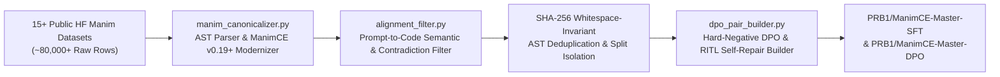

# FinetuningExps — `v1.0-data-pipeline`: ManimCE v0.19+ AST Sanitizer, Alignment Verifier & Master Corpus Pipeline

> **Branch Version:** `v1.0-data-pipeline`  
> **Target Domain:** Programmatic Mathematical Animation Generation (`Manim Community Edition v0.19+`)  
> **Published HuggingFace Datasets:**  
> - **SFT Corpus:** [`PRB1/ManimCE-Master-SFT`](https://huggingface.co/datasets/PRB1/ManimCE-Master-SFT)  
> - **DPO Corpus:** [`PRB1/ManimCE-Master-DPO`](https://huggingface.co/datasets/PRB1/ManimCE-Master-DPO)

---

## 1. Why Existing Open-Source Manim Datasets Fail

During our audit of 50+ public Manim repositories on Hugging Face, we identified two root causes that cripple off-the-shelf LLMs and naive fine-tunes:

1. **Row-Shuffled Prompt-Code Misalignment in Legacy Datasets:**
   - One of the earliest public Manim datasets (`generaleoley/manim-codegen`) contains severely misaligned rows where the natural-language prompt and Python code belong to completely different animations (e.g., Row 0 requests a *"3D cylinder with a 3D coordinate system and the text 'Kiron'"*, while the paired code is `AreaUnderCurveExample` computing $\int_1^3 x^2\,dx$).
   - Over six downstream datasets (`ArunKr/cleaned-manim-dataset`, `ArunKr/merged-manim-instruct`, `thanhkt/manim_code`, `HyperCluster/ManimatorDataset`, `Aarif1430/manim-instruct`, and the raw `output` column of `priyanshutomar2024/adaption-unified-manim-instructions`) merged those unverified pairs directly.
2. **API Version Drift (`ManimGL` / `manimlib` vs. `ManimCE v0.19+`):**
   - Legacy 3Blue1Brown scripts use `from manimlib.imports import *`, `ShowCreation()`, `TexMobject()`, `TextMobject()`, and `CONFIG = {...}`, while early ManimCE v0.14 scripts use `axes.get_graph()`. Mixing these with modern ManimCE v0.19+ (`Create`, `MathTex`, `Tex`, `Text`, `axes.plot`) causes immediate `NameError` and `AttributeError` crashes at runtime.

---

## 2. Pipeline Architecture (`src/data_pipeline/`)



### Key Modules in `v1.0-data-pipeline`

| File | Responsibility |
| :--- | :--- |
| `src/data_pipeline/manim_canonicalizer.py` | Extracts Python code from markdown/CoT wrappers, rejects `manimlib` / `ManimGL` scripts, modernizes safe legacy calls (`ShowCreation` $\rightarrow$ `Create`, `TexMobject` $\rightarrow$ `MathTex`, `TextMobject` $\rightarrow$ `Tex`, `.get_graph` $\rightarrow$ `.plot`), auto-upgrades 2D `Scene` to `ThreeDScene` when `set_camera_orientation` is invoked, rejects forbidden kwargs (`axis_color` on `Axes`, `element_color`), and validates `ast.parse()`. |
| `src/data_pipeline/alignment_filter.py` | Cross-checks domain concepts (`3d_geometry`, `calculus_integral`, `calculus_derivative`, `linear_algebra`, `trigonometry`, `complex_numbers`, `probability_stats`, `graph_theory`), quoted proper nouns, and identifier tokens between prompt and code to eliminate row-shuffled pairs. |
| `src/data_pipeline/dpo_pair_builder.py` | Generates Stage-2 DPO preference pairs `(prompt, chosen, rejected)` by injecting realistic frontier-LLM failure modes (deprecated APIs, invalid `Axes` kwargs, wrong `ThreeDScene` base class, and spatial overlap at `ORIGIN`) plus 2-turn **Renderer-in-the-Loop (RITL)** compiler traceback repair trajectories. |
| `src/data_pipeline/hf_loader.py` | High-speed pure-Python & PyArrow dataset loader supporting `.jsonl`, `.csv`, `.parquet`, and `datasets-server` pagination. |
| `src/data_pipeline/build_master_dataset.py` | End-to-end orchestrator that builds `sft_train.jsonl`, `sft_val.jsonl`, `eval_benchmark.jsonl`, `dpo_train.jsonl`, `dpo_val.jsonl`, and `data/curation_audit_report.json`, and uploads them to HuggingFace Hub (`PRB1`). |

---

## 3. Reproducing the Master Dataset Curation

```bash
export HF_TOKEN="your_hf_token"
python src/data_pipeline/build_master_dataset.py
```
