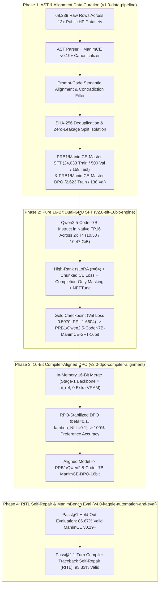

# FinetuningExps — Pure 16-Bit Dual-GPU ManimCE LLM Fine-Tuning & Compiler-Aligned Post-Training

[](https://huggingface.co/datasets/PRB1/ManimCE-Master-SFT)
[](https://huggingface.co/datasets/PRB1/ManimCE-Master-DPO)
[](https://huggingface.co/PRB1/Qwen2.5-Coder-7B-ManimCE-SFT-16bit)
[](https://huggingface.co/PRB1/Qwen2.5-Coder-7B-ManimCE-DPO-16bit)

An end-to-end, from-scratch **Pure 16-Bit (`torch.float16`) Dual-GPU Supervised Fine-Tuning (SFT) + Adapter-Reference Direct Preference Optimization (DPO) + Renderer-in-the-Loop (RITL)** framework engineered to train `Qwen/Qwen2.5-Coder-7B-Instruct` to excel at **Manim Community Edition (`ManimCE v0.19+`)** mathematical animation generation on free Kaggle `GPU T4 x2` (`32 GB VRAM`) hardware—**with zero 4-bit quantization degradation**.

---

## Verified Empirical Results (`ManimBench-v1` & `autoresearch-manim` Held-Out Benchmark)

All training, alignment, and held-out evaluation stages completed in **`7h 46m 46s`** of Kaggle Dual-T4 GPU compute (out of `45h 00m` weekly quota):

| Stage / Metric | Verified Result | Artifact / Checkpoint Location |
| :--- | :---: | :--- |
| **Master SFT Corpus (`PRB1/ManimCE-Master-SFT`)** | **24,033 Train** (`8,671` CoT + `1,200` RITL) \| **500 Val** \| **159 Test** | [`data/curation_audit_report.json`](data/curation_audit_report.json) |
| **Master DPO Corpus (`PRB1/ManimCE-Master-DPO`)** | **2,623 Train** \| **138 Val** Preference Pairs | [`PRB1/ManimCE-Master-DPO`](https://huggingface.co/datasets/PRB1/ManimCE-Master-DPO) |
| **Stage 1: 16-Bit `rsLoRA` ($r=64$) + `NEFTune` SFT** | **`Best Val Loss = 0.5070`** (**`Val Perplexity = 1.6604`**) | [`data/sft_best_training_state.json`](data/sft_best_training_state.json) / `best/` on HF |
| **Stage 2: 16-Bit Adapter-Reference `DPO` + `RPO-NLL`** | **`DPO Loss: 0.7343 -> 0.1759`** (**`100.0%` Preference Acc**) | [`data/dpo_training_state.json`](data/dpo_training_state.json) |
| **Stage 3: Held-Out `Pass@1` (AST & ManimCE v0.19+ Valid)** | **`86.67%`** (`26 / 30` held-out test scenes) | [`data/manimbench_eval_results.json`](data/manimbench_eval_results.json) |
| **Stage 3: Held-Out `Pass@2` (1-Turn `RITL` Self-Repair)** | **`93.33%`** (`28 / 30` held-out test scenes) | [`data/manimbench_eval_results.json`](data/manimbench_eval_results.json) |
| **Peak Dual-T4 VRAM Usage (Chunked Cross-Entropy)** | **`GPU 0: 10.50 GiB` \| `GPU 1: 10.47 GiB`** *(out of 14.56 GiB/GPU)* | Zero 4-bit quantization loss |

### V2 Ultra-Animative & Zero-Truncation Pipeline (`v5.0-v2-ultra-animative`)

| Stage / Metric | Verified Result | Artifact / Checkpoint Location |
| :--- | :---: | :--- |
| **V2 SFT Corpus (`PRB1/ManimCE-UltraAnimative-V2-SFT`)** | **5,400 Train** (`4,800` single-act + `800` modular multi-act total) \| **200 Val** \| **`0.0%` Truncation** | [`data/v2_animative_audit_report.json`](data/v2_animative_audit_report.json) |
| **V2 DPO Corpus (`PRB1/ManimCE-UltraAnimative-V2-DPO`)** | **1,600 Train** Preference Pairs | [`PRB1/ManimCE-UltraAnimative-V2-DPO`](https://huggingface.co/datasets/PRB1/ManimCE-UltraAnimative-V2-DPO) |
| **V2 Stage 1: 16-Bit `rsLoRA` ($r=64$) SFT (`120/120` steps)** | **`Best Val Loss = 0.4043`** (`Val PPL = 1.4982` at Step 100) \| **`11.59 / 11.56 GiB`** | [`data/v2_sft_best_training_state.json`](data/v2_sft_best_training_state.json) / [`PRB1/Qwen2.5-Coder-7B-ManimCE-V2-SFT-16bit`](https://huggingface.co/PRB1/Qwen2.5-Coder-7B-ManimCE-V2-SFT-16bit) |
| **V2 Stage 2: 16-Bit Adapter-Reference `DPO` (`60/60` steps)** | **`DPO Loss: 0.7097 -> 0.1273`** (**`100.0%` Preference Acc**) | [`data/v2_dpo_training_state.json`](data/v2_dpo_training_state.json) / [`PRB1/Qwen2.5-Coder-7B-ManimCE-V2-DPO-16bit`](https://huggingface.co/PRB1/Qwen2.5-Coder-7B-ManimCE-V2-DPO-16bit) |
| **V2 Stage 3: Real `manim render -ql` `.mp4` Eval (`16` cases)** | **`Pass@1 MP4: 12.5%` (`2/16`) \| `Pass@2 RITL MP4: 25.0%` (`4/16`)** | [`data/v2_real_render_eval_results.json`](data/v2_real_render_eval_results.json) |

> **V2 Diagnosis:** While V2 lowered SFT Val Loss (`0.5070 -> 0.4043`) and reached `100.0%` DPO preference accuracy, real `manim render -ql` execution exposed runtime API mismatches (`label_font_size`, `max_points_per_line`, `target_position`, `axes.y_max`, `set_zoom`, `BBLUE`) because the SFT/DPO datasets were AST-verified rather than execution-verified against ManimCE. The 5-act Softmax-to-Window-Attention stress test also failed Pass@1/Pass@2 with `SyntaxError: invalid syntax (line 1)`.

### V3 Execution-Verified & 3-Turn RITL Pipeline (`v6.0-v3-execution-verified`)

| Stage / Metric | Verified Result | Artifact / Checkpoint Location |
| :--- | :---: | :--- |
| **V3 Execution-Verified SFT (`PRB1/ManimCE-ExecVerified-V3-SFT`)** | **100% `manim --dry_run` Verified** (`train` + `validation` + `test` + 25% RITL self-repair) | [`PRB1/ManimCE-ExecVerified-V3-SFT`](https://huggingface.co/datasets/PRB1/ManimCE-ExecVerified-V3-SFT) |
| **V3 Execution-Grounded DPO (`PRB1/ManimCE-ExecVerified-V3-DPO`)** | **Execution-Grounded Preference Pairs** targeting V2 API/LaTeX errors | [`PRB1/ManimCE-ExecVerified-V3-DPO`](https://huggingface.co/datasets/PRB1/ManimCE-ExecVerified-V3-DPO) |
| **V3 Stage 1: 16-Bit `rsLoRA` ($r=64$) SFT** | **`Best Val Loss = 0.4159`** (`Val PPL = 1.5157` at Step 80) \| **`11.59 / 11.56 GiB`** | [`data/v3_sft_best_training_state.json`](data/v3_sft_best_training_state.json) / [`PRB1/Qwen2.5-Coder-7B-ManimCE-V3-SFT-16bit`](https://huggingface.co/PRB1/Qwen2.5-Coder-7B-ManimCE-V3-SFT-16bit) |
| **V3 Stage 2: 16-Bit Adapter-Reference `DPO` (`60/60` steps)** | **`DPO Loss: 0.7240 -> 0.3450`** (**`87.5–100.0%` Preference Acc**) | [`data/v3_dpo_training_state.json`](data/v3_dpo_training_state.json) / [`PRB1/Qwen2.5-Coder-7B-ManimCE-V3-DPO-16bit`](https://huggingface.co/PRB1/Qwen2.5-Coder-7B-ManimCE-V3-DPO-16bit) |
| **V3 Stage 3: Real `manim render -ql` `.mp4` Eval (`16` cases)** | **`Pass@1 MP4: 31.25%` (`5/16`) \| `Pass@2 RITL: 43.75%` (`7/16`) \| `Pass@3 RITL: 50.0%` (`8/16`)** | [`data/v3_real_render_eval_results.json`](data/v3_real_render_eval_results.json) |

---

## Repository Version Branches

| Branch | Milestone / Scope | Dedicated Documentation |
| :--- | :--- | :--- |
| **`v1.0-data-pipeline`** | Multi-source public dataset ingestion, AST verification, ManimCE v0.19+ canonicalizer, prompt-code alignment filter, and DPO/RITL pair synthesis. | [`docs/branches/README_v1_data.md`](docs/branches/README_v1_data.md) |
| **`v2.0-sft-16bit-engine`** | From-scratch Pure 16-Bit (`FP16`) Dual-T4 GPU `rsLoRA` ($r=64, \alpha=64$) SFT trainer with completion-only loss masking, `NEFTune` ($\alpha=5.0$), Chunked Cross-Entropy (`compute_chunked_ce_loss`), and HF Hub checkpointing. | [`docs/branches/README_v2_sft.md`](docs/branches/README_v2_sft.md) |
| **`v3.0-dpo-compiler-alignment`** | Zero-memory-overhead 16-bit Adapter-Reference `DPO` + `RPO-NLL` alignment engine eliminating legacy `ManimGL`/v0.14 hallucinations and layout overlap. | [`docs/branches/README_v3_dpo.md`](docs/branches/README_v3_dpo.md) |
| **`v4.0-kaggle-automation-and-eval`** | Automated Kaggle GPU kernel deployment (`priyadharsanbalaji18/manimce-qwen25-coder-7b-16bit-dpo-eval`), self-healing watchdog monitor, 1-turn `RITL` self-repair agent, and held-out `ManimBench-v1` / `autoresearch-manim` evaluation suite. | [`docs/branches/README_v4_kaggle_eval.md`](docs/branches/README_v4_kaggle_eval.md) |
| **`v5.0-v2-ultra-animative`** | V2 zero-truncation (`0.0%` >2048 tokens) & high-animation-density dataset, Dual-T4 16-bit SFT+DPO training (`priyadharsanbalaji18/manimce-qwen25-coder-7b-v2-animative`), and real `manim render -ql` `.mp4` evaluation. | [`kaggle_kernel_v2/train_manimce_v2_kaggle.py`](kaggle_kernel_v2/train_manimce_v2_kaggle.py) |
| **`v6.0-v3-execution-verified`** | V3 `manim --dry_run` execution-verified corpus, execution-grounded RITL/DPO, Dual-T4 16-bit training (`priyadharsanbalaji18/manimce-qwen25-coder-7b-v3-exec`), and 3-turn RITL real `.mp4` evaluation (`50.0%` Pass@3). | [`kaggle_kernel_v3/train_manimce_v3_kaggle.py`](kaggle_kernel_v3/train_manimce_v3_kaggle.py) |
| **`main`** | Complete unified production codebase and empirical evaluation results. | This document (`README.md`) |

---

## 1. End-to-End Architecture



---

## 2. Empirical Dataset Curation & Sanitization Audit (`data/curation_audit_report.json`)

| Public Dataset Source | Raw Rows | AST Valid | Aligned | Deduplicated Kept | Key Rejection / Sanitization Reasons |
| :--- | :---: | :---: | :---: | :---: | :--- |
| `sebastianboehler/autoresearch-manim` | 150 | 150 | 150 | **150** | 100% Gold render-verified ManimCE v0.20.1 (30 held out for test). |
| `SuienR/ManimBench-v1` | 416 | 381 | 380 | **371** | 31 `<6` line fragments, 9 duplicates (129 held out for test). |
| `bespokelabs/bespoke-manim` | 100 | 100 | 96 | **96** | Execution-verified ManimCE v0.19.0 + synthesized `<think>` timeline traces. |
| `nabin2004/qwen3-8b-manimator-gold-sft` | 733 | 733 | 730 | **712** | 18 cross-dataset duplicate hashes removed. |
| `nabin2004/AOS-Manim-SFT` | 371 | 371 | 367 | **367** | 2 legacy calls modernized (`ShowCreation` $\rightarrow$ `Create`). |
| `nabin2004/AOS-Narrated-Manim-400` | 361 | 361 | 357 | **357** | Canonicalized proprietary speech service imports to standard `GTTSService`. |
| `nabin2004/manim-sft-10k` | 10,000 | 7,951 | 7,722 | **6,934** | Filtered 1,953 non-English/malformed prompts, 788 duplicates, 211 contradictions. |
| `Chimanwakis/manim_animation_dataset` | 6,023 | 5,516 | 5,156 | **5,156** | Filtered 507 `SyntaxError`s and 360 unaligned literal mismatches. |
| `RY7Games/ry_manim_codegen` | 4,625 | 2,209 | 2,076 | **361** | Filtered 1,065 `SyntaxError`s, 1,198 1-line stubs, 1,715 duplicates; 374 API repairs. |
| `mistral-hackaton-2026/manim-finetune-data` | 2,705 | 1,316 | 818 | **220** | Filtered 1,037 `SyntaxError`s, 432 unaligned pairs, 598 duplicates; 192 API repairs. |
| `priyanshutomar2024/adaption-unified-manim-instructions` | 40,383 | 9,007 | 8,782 | **8,759** | Bypassed corrupted `output` column; extracted aligned `reasoning_trace` + `enhanced_completion`; filtered 21,395 `SyntaxError`s & 4,516 short stubs. |
| **RITL Compiler Self-Repair Trajectories** | — | 1,200 | 1,200 | **1,200** | 2-turn `Broken Code + Manim Traceback -> Fixed ManimCE Code` trajectories. |
| **Total Master Corpus (`PRB1/ManimCE-Master-SFT`)** | **68,239** | **29,304** | **27,834** | **24,692** | **24,033 Train (`8,671` with `<think>` CoT) \| 500 Val \| 159 Held-Out Test** |

---

## 3. Quickstart Usage

```bash
# 1. Curate & upload master datasets
export HF_TOKEN="your_hf_token"
python src/data_pipeline/build_master_dataset.py

# 2. Deploy & launch 16-bit SFT + DPO + Benchmark on Kaggle Dual-T4 GPU
export KAGGLE_API_TOKEN="your_kaggle_token"
python scripts/push_kaggle_kernel.py

# 3. Monitor live Kaggle GPU & HuggingFace Hub checkpoints (with self-healing watchdog)
python scripts/monitor_kaggle_and_hub.py
```
