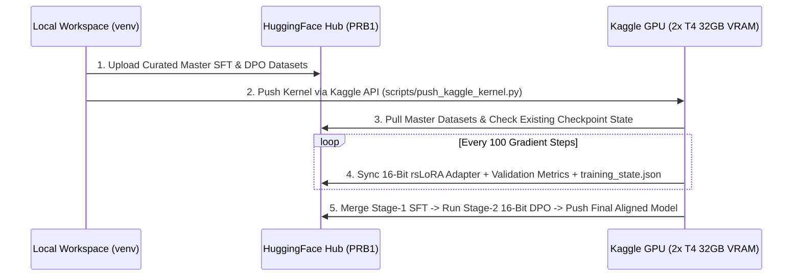

# FinetuningExps — `v4.0-kaggle-automation-and-eval`: Automated Kaggle Dual-T4 GPU Orchestration, RITL Agent & ManimBench Suite

> **Branch Version:** `v4.0-kaggle-automation-and-eval`  
> **Kaggle Kernel ID:** `priyadharsanbalaji18/manimce-qwen25-coder-7b-16bit-sft-dpo`  
> **Evaluation Benchmark:** Held-Out `ManimBench-v1` + `autoresearch-manim` (`PRB1/ManimCE-Master-SFT` `test` split)

---

## 1. End-to-End Kaggle Dual-T4 GPU Automation (`kaggle_kernel/` & `scripts/`)

This release packages the entire 16-bit SFT + 16-bit DPO + Benchmark pipeline into an automated, fault-tolerant Kaggle GPU kernel (`kaggle_kernel/train_manimce_16bit_kaggle.py`) managed directly from the command line:



### Fault-Tolerance & Zero Checkpoint Loss Guarantees
- **Cross-Session Automatic Resumption:** On startup, the Kaggle kernel inspects `PRB1/Qwen2.5-Coder-7B-ManimCE-SFT-16bit` for `training_state.json`. If a previous Kaggle run paused or timed out, it downloads the exact 16-bit adapter weights, fast-forwards the cosine LR scheduler to `global_step`, and continues seamlessly.
- **Wall-Time Safety Guard (`max_walltime_hours = 11.2`):** Automatically flushes a final checkpoint to Hugging Face Hub and exits cleanly before Kaggle's 12-hour session hard limit.

---

## 2. Renderer-in-the-Loop (RITL) Self-Repair Agent (`src/inference/ritl_agent.py`)

At inference time, `generate_manim_with_ritl()` couples the fine-tuned model with static AST verification (`verify_and_canonicalize`) and headless Manim execution (`manim -ql --dry_run`):
1. **Pass 1:** Generates spatial layout reasoning (`<think>...</think>`) + ManimCE v0.19+ Python code.
2. **Verification:** Validates AST syntax, ManimCE v0.19+ API compliance, and headless execution.
3. **Pass 2 (Automatic 1-Turn Compiler Repair):** If any exception occurs, feeds the exact traceback back to the model (using the multi-turn repair format trained during SFT) to produce a repaired script.

---

## 3. Deploying to Kaggle & Running Evaluation

```bash
# Deploy and launch on Kaggle GPU
export KAGGLE_API_TOKEN="your_kaggle_token"
export HF_TOKEN="your_hf_token"
python scripts/push_kaggle_kernel.py

# Run held-out ManimBench-v1 / Autoresearch evaluation
python src/eval/manim_benchmark_eval.py \
  --base_model Qwen/Qwen2.5-Coder-7B-Instruct \
  --adapter_repo PRB1/Qwen2.5-Coder-7B-ManimCE-DPO-16bit \
  --max_cases 60
```

